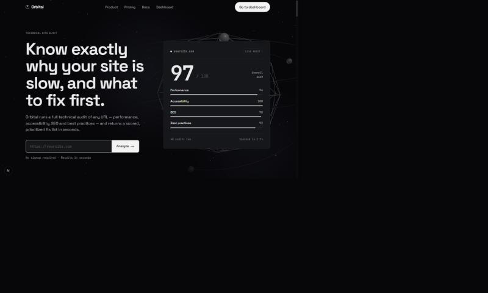
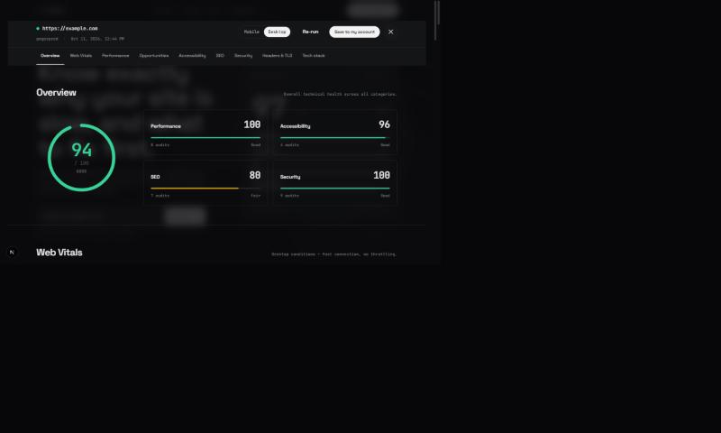
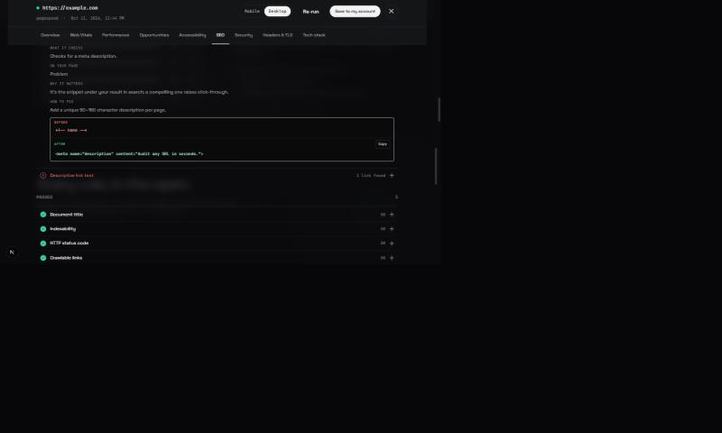
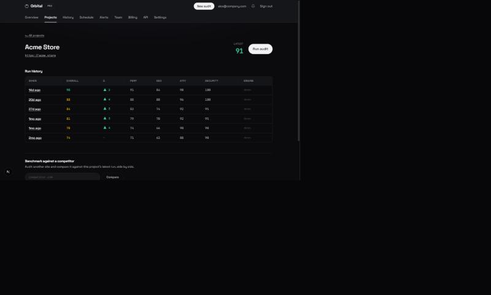
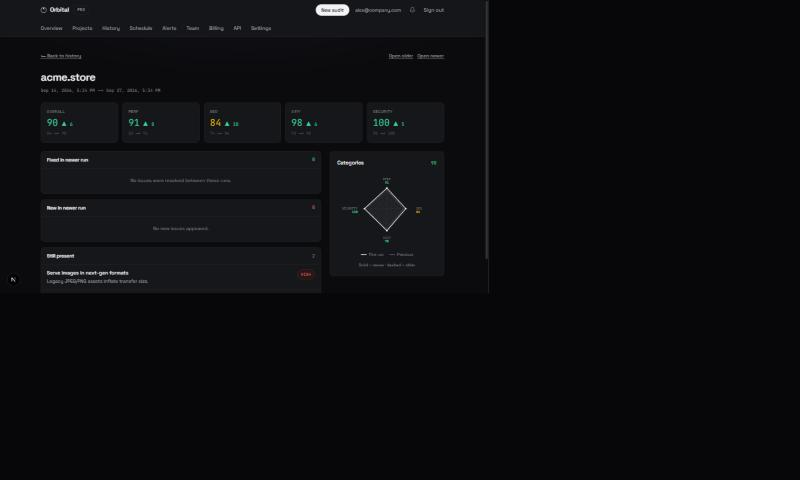
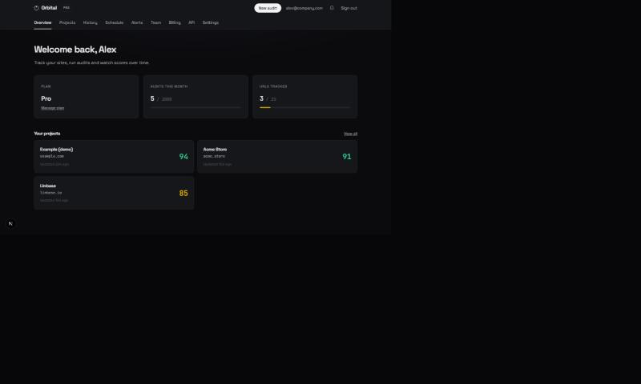
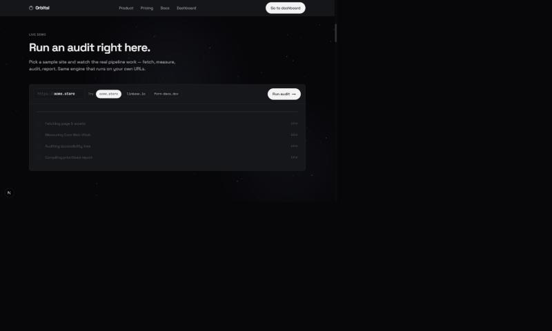
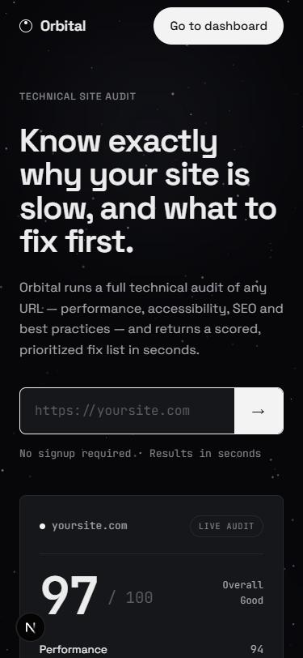
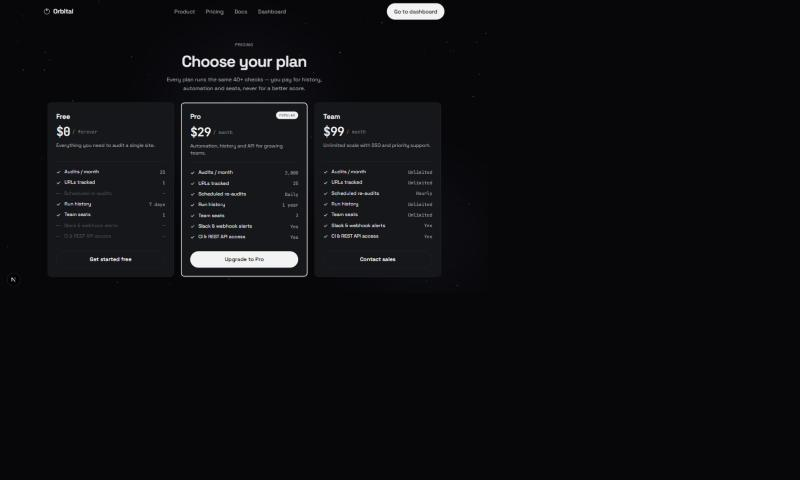

<!-- Marketing README. Replace the placeholder links (your-domain.com) with the live Vercel/custom-domain URL after deploy. -->

<div align="center">



<h1>Orbital</h1>

### Mission control for your website's health.

**Orbital audits any URL in seconds and tells you exactly what to fix first** — scored across Performance, SEO, Accessibility and Security, with every issue explained in plain English and copy-paste code to fix it.

<p>
  <a href="https://your-domain.com"></a>
  <a href="https://your-domain.com/#report"></a>
  <a href="https://your-domain.com/pricing"></a>
</p>

<sub>Built with</sub><br/>


</div>

---

## A score tells you where you stand. Orbital tells you what to do next.

Most tools hand you a number and a wall of two hundred warnings. Orbital hands you a **ranked plan**: the handful of fixes that actually move your score, each one explained, each one with the exact snippet to paste in.

No signup. No install. Paste a URL, get a full report in seconds.

<div align="center">
  
</div>

<!-- TODO: drop in a short GIF of a live audit running (loader → report) here when you have a screen recording. -->

## Not just *what's* wrong — the exact fix

Every check expands into a full explanation: what it checks, what it found on your page, why it matters, and a **before / after code block you can copy straight into your project.** Even passing checks tell you what you're doing right.

<div align="center">
  
</div>

## Everything you get

| | |
|---|---|
| 🎯 **One honest number** | A 0–100 score across Performance, SEO, Accessibility and Security — plus the breakdown behind it. |
| 🧭 **A ranked fix list** | Issues ordered by the points each fix returns, not severity noise. No 200-warning dumps. |
| 💻 **Copy-paste fixes** | Real before/after code for every finding — paste it and move on. |
| ⚡ **Real Core Web Vitals** | Lab metrics plus real-world field data (CrUX) from actual Chrome users. |
| 🔒 **Security & TLS** | Live certificate inspection, security-header checks and HTTPS validation. |
| 🧱 **Tech-stack detection** | See the frameworks, CDNs and analytics a site runs on. |
| 📈 **Track over time** | Every run saved — watch scores climb and catch regressions. |
| ⚔️ **Benchmark competitors** | Audit any rival URL and compare side by side. |
| ⏱️ **Scheduled audits & alerts** | Re-audit on a schedule; get pinged when a score drops. |
| 👥 **Teams, API & sharing** | Team seats, a public REST API, and shareable report links. |

## Watch your scores climb

Orbital saves every run, so you can see progress over time and catch regressions the moment they land — complete with per-category deltas.

<div align="center">
  
</div>

<!-- TODO: a GIF scrolling through a report or expanding checks works great here. -->

## Beat your competition

Point Orbital at a competitor's URL and compare runs side by side — what you fixed, what regressed, and where you still trail, across every category.

<div align="center">
  
</div>

## A home base for your whole team

Projects, history, scheduled re-audits, alerts, billing and an API — all in one calm, fast dashboard.

<div align="center">
  
</div>

## Try it in one click — no signup

Paste a URL on the landing page and watch the real pipeline run. The guest audit uses the exact same engine as paid plans.

<div align="center">
  
  &nbsp;
  
</div>

<div align="right"><sub>Looks great on every screen ↑</sub></div>

## Simple, honest pricing

Every plan runs the **same** 40+ checks — you pay for history, automation and seats, never for a better score.

| | Free | Pro | Team |
|---|---|---|---|
| **Price** | $0 forever | $29 / mo | $99 / mo |
| Audits / month | 25 | 2,000 | Unlimited |
| URLs tracked | 1 | 25 | Unlimited |
| Run history | 7 days | 1 year | Unlimited |
| Scheduled re-audits | — | Daily | Hourly |
| Team seats | 1 | 3 | Unlimited |
| Slack & webhook alerts | — | ✓ | ✓ |
| Public REST API | — | ✓ | ✓ |

<div align="center">
  
</div>

## Get started

<div align="center">

### Audit your site in the next 10 seconds — free, no signup.

<a href="https://your-domain.com"></a>

</div>

---

<details>
<summary><b>Running Orbital yourself (developers)</b></summary>

<br/>

Orbital is a Next.js 16 app. It runs with **zero config** — with no API keys the guest audit serves realistic demo data; add keys to unlock real audits, accounts and billing.

```bash
npm install
cp .env.example .env.local   # fill in the keys you have (all optional for the demo)
npm run dev                  # http://localhost:3000
```

Accounts and the dashboard are backed by Supabase — apply the SQL in `supabase/migrations/` (in order). Deploys to Vercel out of the box; set the environment variables from `.env.example` in your project settings. See the comments in `.env.example` for what each key unlocks.

</details>

<div align="center"><sub>Orbital — mission control for your website's health.</sub></div>


