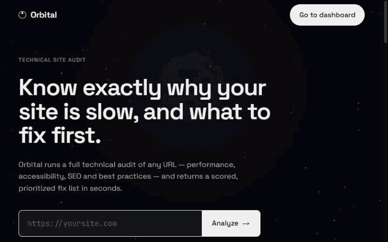

<div align="center">

<a href="https://useorbital.com">
  
</a>

<br/><br/>

<h1>Orbital</h1>

<p align="center">
  <strong>Mission control for your website's health, Core Web Vitals & security.</strong><br/>
  Instant URL telemetry, 46+ automated checks, ranked action plans with copy-paste code fixes, and automated regression monitoring.
</p>

<p align="center">
  <a href="https://useorbital.com"><strong>Run a Live Audit »</strong></a>
  &nbsp;•&nbsp;
  <a href="#-interactive-preview"><strong>View Product Tour</strong></a>
  &nbsp;•&nbsp;
  <a href="#-features"><strong>Explore Features</strong></a>
  &nbsp;•&nbsp;
  <a href="#-developer-quickstart"><strong>Developer Quickstart</strong></a>
  &nbsp;•&nbsp;
  <a href="https://useorbital.com/pricing"><strong>Pricing</strong></a>
</p>

<p align="center">
  <a href="https://github.com/your-username/orbital/stargazers"></a>
  <a href="https://github.com/your-username/orbital/blob/main/LICENSE"></a>
  <a href="https://nextjs.org"></a>
  <a href="https://react.dev"></a>
  <a href="https://tailwindcss.com"></a>
  <a href="https://supabase.com"></a>
  <a href="https://developer.chrome.com/docs/crux"></a>
</p>

<br/>

<a href="https://useorbital.com">
  
</a>

<p align="center">
  <sub>▲ Real-time interface preview: Landing Telemetry → Instant Report → Actionable Fixes → Mission Control Dashboard → Competitor Benchmark</sub>
</p>

</div>

---

## ⚡ Why Orbital?

Most website performance tools hand you a confusing score and a **wall of 200 technical warnings**, leaving you guessing what actually moves the needle.

**Orbital is built differently:**

1. **Ranked ROI Plan** — We calculate the exact score gain for each fix. Solve the top 3 issues first, gain +18 points immediately.
2. **Copy-Paste Code Fixes** — Every finding includes exact `before` / `after` code snippets for React, Next.js, HTML, and web servers.
3. **Real Field Data (CrUX) + Lab Engine** — Real Chrome 75th-percentile user telemetry (LCP, INP, CLS) combined with headless synthetic audits.
4. **Zero-Friction Guest Mode** — Paste any URL on the homepage and get a comprehensive 46-point diagnostic in seconds. No credit card, no signup required.

---

## 🔭 Interactive Preview

<details open>
<summary><b>1. Instant Audit & Category Breakdown (98 / 100)</b></summary>
<br/>

Get one clear composite score across 4 pillars: **Performance**, **SEO**, **Accessibility (WCAG 2.1)**, and **Security & TLS**. Every check tells you what passed, what failed, and why it impacts real users.

<div align="center">
  
</div>
</details>

<br/>

<details>
<summary><b>2. Ranked Action Plan & Copy-Paste Fixes</b></summary>
<br/>

No vague guidelines. Expand any flagged issue to inspect the affected elements, technical diagnosis, and production-ready snippets ready to paste into your codebase.

<div align="center">
  
</div>
</details>

<br/>

<details>
<summary><b>3. Mission Control Dashboard & Team Workspace</b></summary>
<br/>

A high-density Swiss monochrome dashboard to monitor multiple domains, schedule automatic audits (hourly/daily), set Slack score-drop alerts, and invite teammates with role-based access.

<div align="center">
  
</div>
</details>

<br/>

<details>
<summary><b>4. Side-by-Side Competitor Benchmark (Versus Mode)</b></summary>
<br/>

Pit your website against any competitor URL. Compare Core Web Vitals, category radars, page weight, TTFB, and detect their underlying tech stack.

<div align="center">
  
</div>
</details>

---

## 🚀 Key Features

| Capability | Description |
|:---|:---|
| 🎯 **Honest 0–100 Scoring** | Calibrated across Performance, SEO, Accessibility, and Security with zero synthetic fluff. |
| 🧭 **Ranked Action Plan** | Issues ordered strictly by score recovery value. Never waste hours on negligible micro-optimizations. |
| 💻 **Ready Code Snippets** | Tested before/after code blocks for Next.js Image, bundle chunking, font display, and security headers. |
| ⚡ **CrUX Field Telemetry** | Real-world 75th-percentile Core Web Vitals (Largest Contentful Paint, Interaction to Next Paint, Cumulative Layout Shift). |
| 🔒 **Deep Security & TLS** | Certificate lifespan, cipher negotiation, HSTS preload, Content-Security-Policy, and cookie security flags. |
| 🧱 **Tech Stack Fingerprint** | Identifies CDNs, front-end frameworks, CMSs, hosting providers, and third-party trackers. |
| ⏱️ **Automated Re-Audits** | Set scheduled audits (daily / hourly) and detect performance regressions before your users notice. |
| 🔔 **Multi-Channel Alerts** | Instant webhook notifications to Slack, Discord, or in-app feeds whenever scores cross critical thresholds. |
| 👥 **Team Seats & RBAC** | Collaborative organization workspaces with Member and Admin seat management. |
| 🌐 **Public Share Links** | Generate clean, shareable read-only report URLs for clients, teammates, or stakeholders. |

---

## 💻 Developer Quickstart

Orbital runs as a modern Next.js 16 application with zero mandatory cloud dependencies for local evaluation — without API keys, the engine automatically serves realistic sample telemetry.

### 1. Clone & Install

```bash
git clone https://github.com/your-username/orbital.git
cd orbital
npm install
```

### 2. Configure Environment

```bash
cp .env.example .env.local
```

*(All keys are optional for local demo mode. Add Supabase, Stripe, and Upstash keys whenever you are ready to enable persistent accounts, webhooks, and live crawler workers).*

### 3. Run Development Server

```bash
npm run dev
```

Open [http://localhost:3000](http://localhost:3000) in your browser.

### 4. Run Headless CLI Audit

You can also run audits directly from your terminal:

```bash
npm run audit -- https://example.com
```

---

## 🛠️ Architecture & Tech Stack

Orbital is engineered following Swiss monochrome design principles — prioritizing information density, clean hairlines, and sub-100ms response times.

```
┌─────────────────────────────────────────────────────────────┐
│                       ORBITAL ENGINE                        │
├──────────────────────────────┬──────────────────────────────┤
│ FRONTEND LAYER               │ DATA & BACKEND ENGINE        │
│ • Next.js 16 (Turbopack)     │ • Supabase (PostgreSQL + RLS)│
│ • React 19 + Framer Motion   │ • Upstash QStash (Crons)     │
│ • Tailwind CSS v4 (Pure CSS) │ • Chrome UX Report (CrUX API)│
│ • Recharts + Lucide Icons    │ • Headless Chromium Sandbox  │
│ • Three.js Telemetry Canvas  │ • Stripe Subscriptions       │
└──────────────────────────────┴──────────────────────────────┘
```

- **App Router & Server Actions**: Zero-waterfall data fetching with React Server Components.
- **Swiss Monochrome Palette**: High-contrast, accessibility-compliant typography (Space Grotesk + JetBrains Mono) with automatic Dark Mode support.
- **Resilient Cron Queue**: Decoupled asynchronous worker processing via Upstash QStash.

---

## 💳 Honest, Transparent Pricing

Every plan runs the exact same comprehensive 46+ checks. You only pay for automation frequency, team seats, and historical retention.

| Feature | Free | Pro | Team |
|:---|:---:|:---:|:---:|
| **Price** | **$0 / mo** | **$29 / mo** | **$99 / mo** |
| Audits per month | 25 | 2,000 | Unlimited |
| Tracked Domains | 1 | 25 | Unlimited |
| History Retention | 7 days | 1 year | Unlimited |
| Scheduled Re-Audits | Manual | Daily | Hourly |
| Team Members | 1 seat | 3 seats | Unlimited |
| Slack & Webhook Alerts | — | Included | Included |
| Competitor Benchmarking | Included | Included | Included |
| Public REST API | — | Included | Unlimited |

---

## 🤝 Contributing

Contributions, bug reports, and pull requests are warmly welcomed!

1. Fork the Project
2. Create your Feature Branch (`git checkout -b feature/AmazingFeature`)
3. Commit your Changes (`git commit -m 'Add some AmazingFeature'`)
4. Push to the Branch (`git push origin feature/AmazingFeature`)
5. Open a Pull Request

---

## 📄 License

Distributed under the **MIT License**. See [`LICENSE`](LICENSE) for more information.

<br/>

<div align="center">
  <sub>Crafted with precision for web engineers, founders, and performance obsessives.</sub><br/>
  <sub>© 2026 Orbital Technologies. All rights reserved.</sub>
</div>
